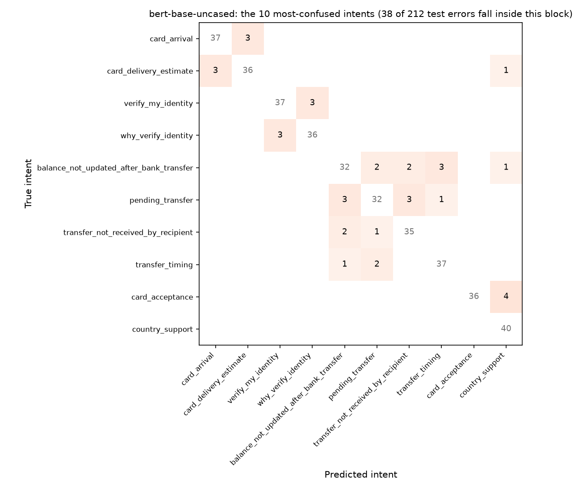

# support-intent-classifier

Routes customer-support messages to one of 77 intents (BANKING77). It compares a strong classical baseline against two fine-tuned transformers, trained with a hand-written PyTorch loop.

## Results

Official BANKING77 test split: 3,080 messages, 77 intents. The best epoch is selected on a held-out validation split (10% of training, stratified), and the test split is evaluated once at the end.

| Model | Params | Test accuracy | Macro-F1 | Training time (Apple M4, MPS) |
|---|---|---|---|---|
| Majority class | - | 1.3% | - | - |
| TF-IDF (word 1-2 grams + char 3-5 grams) + logistic regression | - | 91.2% | 0.912 | about 1 min (CPU) |
| DistilBERT, fine-tuned 5 epochs | 67M | 92.4% | 0.924 | 10 min |
| **BERT-base, fine-tuned 6 epochs** | 110M | **93.1%** | **0.931** | 42 min |

BERT-base cuts the error rate from 8.8% to 6.9%: **22% fewer misrouted messages** than the baseline. The baseline is deliberately strong. Character n-grams catch most of the intents' surface vocabulary, so the transformers win on the remaining semantic cases.

The most common remaining mistakes are genuinely close intents:

| True intent | Predicted as |
|---|---|
| `top_up_reverted` | `top_up_failed` |
| `card_acceptance` | `country_support` |
| `why_verify_identity` | `verify_my_identity` (DistilBERT) |

Full metrics, per-epoch history and confusions are in `results/*.json`.

### Where BERT still gets confused



The figure zooms in on the 10 intents that make up BERT's most-confused pairs (`uv run python -m intent.confusion`). Numbers are message counts; the shading is the share of each true intent's test messages, with the diagonal left blank.

- **The four bank-transfer intents behave like one blurred class.** `balance_not_updated_after_bank_transfer`, `pending_transfer`, `transfer_not_received_by_recipient` and `transfer_timing` swap with each other 20 times in 160 test messages. All four describe the same situation (money sent, not there yet) from different angles, so the wording rarely says which one the customer means.
- **The other pairs are near-synonyms:** `card_arrival` and `card_delivery_estimate`, `verify_my_identity` and `why_verify_identity`, and `card_acceptance` misread as `country_support`. (`top_up_reverted` misread as `top_up_failed` also has 4 errors; it ties with the `card_acceptance` pair for the last two slots and misses the cut only on the tie-break.)
- **Most errors are not in this block.** Only 38 of the 212 test errors fall inside it. 116 of the misroutes are one-off pairs that happen exactly once, so no single merge or extra rule would fix them. That long tail is where more labelled data would matter.

DistilBERT picks the same 10 intents (`results/confusion-distilbert-base-uncased.json`), with 23 swaps inside the transfer cluster instead of 20.

## Data checks

- **Exact duplicates.** 4 training texts are exact duplicates (none with conflicting labels).
- **Train/test overlap.** 7 of the 3,080 test messages also appear verbatim in the training data (0.2%). That's too small to move the results, but it is tested and documented rather than assumed away.

## How it works

- `data.py` loads the CSVs, builds a fixed stratified validation split (seed 13), and keeps the test split untouched.
- `baseline.py` builds a TF-IDF feature union and a logistic regression in scikit-learn.
- `train.py` is a plain PyTorch fine-tuning loop (no Trainer abstraction):
  - AdamW, linear warmup/decay, gradient clipping
  - dynamic padding per batch
  - best-on-validation checkpointing
  - runs on CUDA, Apple MPS, or CPU
- `confusion.py` runs a checkpoint over the test split, saves the full confusion matrix, and plots the most-confused intents.
- `predict.py` gives top-3 intents with probabilities for any message.

```bash
uv sync
uv run python -m intent.baseline
uv run python -m intent.train --model distilbert-base-uncased --epochs 5
uv run python -m intent.train --model bert-base-uncased --epochs 6 --lr 4e-5
uv run python -m intent.predict "my card still hasn't arrived" "why do you need to verify my identity?"
uv run python -m intent.confusion --model bert-base-uncased
uv run pytest
```

## Data

BANKING77 by PolyAI (Casanueva et al., 2020, "Efficient Intent Detection with Dual Sentence Encoders"), redistributed in `data/` under [CC BY 4.0](https://creativecommons.org/licenses/by/4.0/) from [PolyAI-LDN/task-specific-datasets](https://github.com/PolyAI-LDN/task-specific-datasets).
